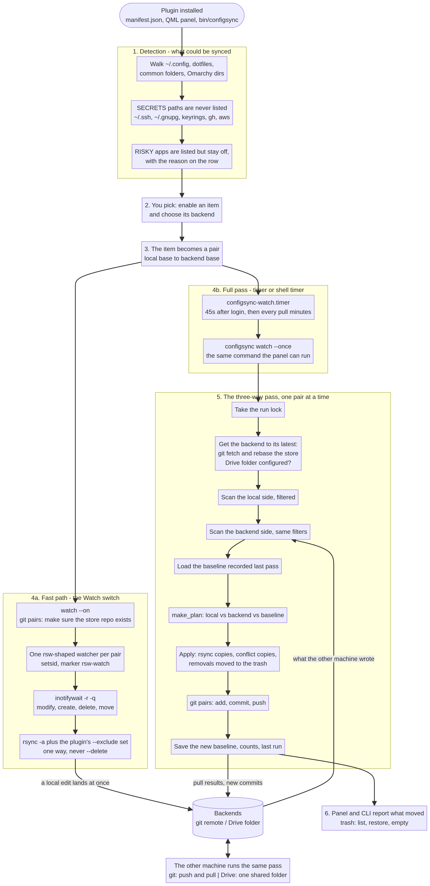
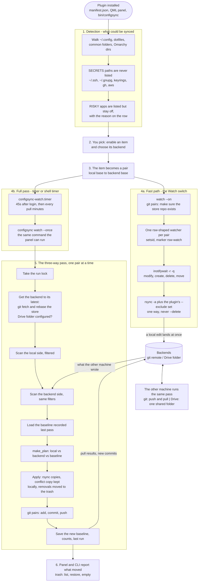
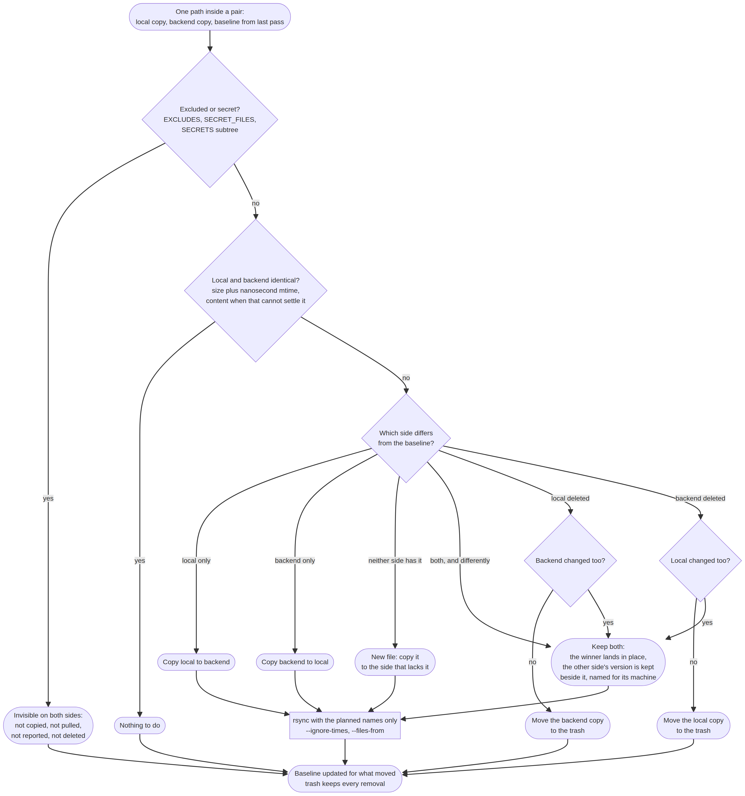
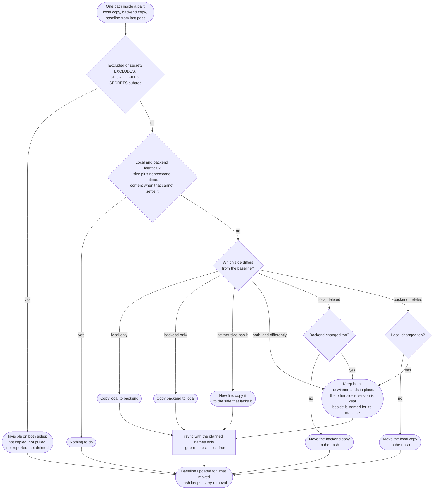

# How the plugin works, end to end

This is the whole procedure: what happens when the shell loads it, what a watcher
is, what the periodic pass does step by step, how the two mechanisms divide the
work, and what happens when two machines disagree.





## The mental model in four nouns

- **Item** — one thing you sync: an app config, a dotfile, a folder such as
  `~/Documents`. It has a name, one or more paths, a backend and an on/off state.
- **Pair** — an enabled item, resolved to two concrete roots: the local base and
  the backend base. Every mechanism below works on pairs.
- **Backend** — where the pair's copies live. `git` means the local store
  (`~/.local/share/omarchy-configsync/git`), which is a real repository that is
  pushed to a remote you can also clone on another machine. `gdrive` means a
  folder you already have synced or mounted, typically by rclone.
- **Baseline** — what the last successful pass recorded for each path of the pair
  (size and nanosecond mtime per side). It is the third input that turns "these
  two files differ" into "this side changed, that side did not".

## Where everything lives

| Path | What it is |
| --- | --- |
| `~/.config/omarchy/configsync.json` | machine-local state: items, backends, switch. Excluded from every sync, always |
| `~/.local/share/omarchy-configsync/git` | the git backend's working tree, a real repo with a `.git` |
| `~/.local/share/omarchy-configsync/baseline/<pair>.json` | per-pair baseline, written after each successful pass |
| `~/.local/share/omarchy-configsync/trash/<timestamp>/<side>/<rel>` | everything a sync removed, with `index.json` recording where it came from |
| `~/.local/share/omarchy-configsync/lock` | the flock every operation takes |
| `~/.config/systemd/user/configsync-watch.timer` + `.service` | the periodic full pass |
| `bin/configsync` | the CLI that does all of the above; the QML never does work itself |

## Stage by stage

### 1. Detection

`configsync scan` (and the panel's Rescan action) walks `~/.config`, the known
dotfiles, the common folders and the Omarchy config directories, and writes what
it finds into the state file. Three filters apply before anything is listed:

- `SECRETS` — whole paths that are never listed and cannot be added by hand:
  `~/.ssh`, `~/.gnupg`, `~/.config/gh`, keyrings, `.aws`, `.docker`,
  `.password-store`, `.netrc`. `configsync add` refuses them outright.
- `RISKY` — apps that exist and are detectable but carry sessions or credentials
  (browsers, VS Code, Bitwarden, Proton, Obsidian). They are listed with
  `enabled: false` and a note explaining why, so the row appears in the panel with
  a warning glyph and stays off until you say otherwise.
- `SKIP_CONFIG` / `OMARCHY_DIRS` — things that are not worth offering.

### 2. Your choices

Per item: on or off, and which backend. Two global settings: the git remote and
branch, and the Drive folder. `configsync state` prints all of it as JSON, which
is what the panel reads.

### 3. The pair

For every enabled item the CLI resolves the two roots. A path that is a directory
maps to a directory; a single file (a dotfile) maps to a single file, and if the
backend has a directory where the local side has a file, the names are adjusted
so both sides agree. That resolution is `pair_bases()`, and everything downstream
uses it, including the watchers.

### 4a. The fast path: the watchers

Turning the switch on (`configsync watch --on`, the panel's Watch switch, or
`set-backend watch enabled true`) does three things:

1. Makes sure the git store exists as a repository, because a git pair's
   destination *is* that store and rsync cannot create a repository.
2. Starts **one watcher per pair**, in the same shape Omarchy's `rsw` starts one:
   `setsid --fork env RSYNC_RSH=… bash -c '<loop>' rsw-watch <local> <backend>`.
   The loop runs one `rsync` immediately and then waits on
   `inotifywait -r -q -e modify,create,delete,move` and copies again after every
   event.
3. Leaves the periodic pass armed (next section), because a watcher can only ever
   see *local* changes.

What a watcher does and does not do:

- **One way only, and no `--delete`.** It copies local to backend. It can create
  and update; it can never remove anything on either side. Removals are decisions
  that need the other side's state, so they belong to the pass.
- **It carries the plugin's exclusion rules.** `rsw` itself takes two arguments
  and no flags, so its `rsync` cannot be given `--exclude`; the plugin runs the
  same loop with `--exclude` arguments built from the same pattern list the scan
  uses (`EXCLUDES` plus `SECRET_FILES`, minus the secret list for an item that
  explicitly opted in). Without that, caches, `node_modules`, `.git` directories
  and secret files would ride the fast path into the backend.
- **It is identifiable and stoppable by the platform tooling.** `lsw` lists it,
  `dsw` stops it, and `configsync watch --stop` stops only the watchers whose
  source this plugin owns — a watcher you started yourself for your own work
  survives. `--stop --all` is the `dsw` behaviour.
- **It reuses one SSH connection** per login (`RSYNC_RSH` with a ControlMaster
  socket), so a remote destination prompts once.
- **Two gaps are known and bounded.** The initial `rsync` runs before
  `inotifywait` is armed, so a write landing in that moment waits for the next
  event; and rsync's quick check is size plus whole-second mtime, so a same-size
  edit saved inside the same second does not travel on the fast path. Both are
  caught by the next full pass, which compares nanoseconds and, when the stamps
  cannot settle it, content.

### 4b. The periodic pass

`configsync-watch.timer` runs `configsync watch --once` 45 seconds after boot,
once more a minute after the timer starts, and then every `pull` minutes after
each pass finishes (10 by default, `set-backend watch pull <n>`). On a machine
with no systemd user session, `Service.qml` runs the identical command on a Qt
timer instead. The pass is what:

- pulls what the **other machine** wrote (inotify cannot see it),
- commits and pushes what the watchers copied into the git store,
- and propagates removals, which the watchers deliberately never do.

### 5. The full pass, step by step

For each pair, under one lock:

1. **Take the lock.** `flock` on `~/.local/share/omarchy-configsync/lock`,
   non-blocking: a second run reports "another operation is running" instead of
   interleaving, and the timer simply skips that cycle.
2. **Get the backend to its latest first.** For a git pair: make sure the store
   is a repository, `git fetch`, and `git reset --hard origin/<branch>` — the
   store becomes exactly what the remote holds, deletions included. There is no
   merge and no rebase: git is transport, so the comparison is against the
   remote's real content and nothing has to be resolved by hand. A file a
   watcher copied into the store since the last pass survives as untracked; it
   came from the local side, which this pass scans anyway. For a Drive pair: a
   folder that is not configured is skipped, and one that is not there is
   reported as an error for that item.
3. **Scan the local side**, then **scan the backend side**, with the same filters
   — so an excluded or secret file is invisible on *both* sides rather than
   looking like a new file on one of them.
4. **Load the baseline** for the pair.
5. **Plan**: `make_plan()` compares the three inputs per path and produces a list
   of decisions (next section). `--dry-run` prints exactly this and stops.
6. **Apply**: copies go through `rsync` with only the planned names, fed over
   stdin NUL-separated (`--from0 --files-from=-`) so spaces and newlines in names
   cannot be mangled, and with `--ignore-times` so a copy the plan decided on is
   never silently skipped by rsync's own coarse check.
7. **Roll and publish** for git pairs: `git add -A`, fold the result into the
   branch's single commit (`--amend`; a longer history is flattened to one
   commit), and push with `--force-with-lease`. A refused lease means another
   machine published first — nothing is lost, the next pass reconciles against
   that content. The message names what moved and when.
8. **Save the baseline** and the run's counts, timestamp and result into the state
   file, which is what the panel and `configsync state` report.

### 6. Reporting and the trash

The panel shows the last result and the live watcher count; the CLI prints what
moved per item. Everything a pass removed sits in the trash under
`<timestamp>/<side>/<rel>`, with an index entry recording the path it came from —
that is what makes restore possible. `configsync trash list` prints the index,
`trash restore` puts the most recent entry back where it was, `trash restore-all`
puts back everything still pending, and `trash empty` clears the lot. A restore
never overwrites what is there now: it keeps both, with the usual conflict name.
The index is capped at the last 500 entries.

## The per-file decision





| Local vs backend | vs baseline | What happens |
| --- | --- | --- |
| identical | anything | nothing |
| differ | only local changed | local wins, copied to the backend |
| differ | only the backend changed | the backend wins, copied to the local side |
| differ | both changed, differently | **both are kept**: the winner lands in place, the loser is copied beside it as `<name>.conflict-<machine>-<stamp><ext>` — a local artefact that is never published; `configsync conflicts prune` retires the old ones to the trash |
| one side missing | the missing side was never there | the file is new, copied to the side that lacks it |
| one side missing | that side is where the baseline had it | a removal: the surviving copy moves to the trash, so it can be restored |
| one side missing | both sides changed | treated as a conflict, not as a removal |
| excluded or secret | anything | invisible on both sides: not copied, not pulled, not reported, not deleted |

Removals are propagated to a git pair always, and to a Drive pair only when you
ask for it (`configsync set-backend gdrive delete true`) — a Drive folder is
usually shared with things this tool knows nothing about, so the default is to
leave it alone.

## A round trip in practice

Two machines, both with the switch on, both syncing `~/.config/ghostty` and
`~/Documents` to the same git remote and Drive folder:

1. On A you edit `~/.config/ghostty/config`. The watcher's inotifywait wakes,
   its `rsync` copies the file into A's store within a second. The file is now in
   the backend but not yet in git.
2. Within `pull` minutes, A's timer runs `watch --once`: it scans both sides, sees
   the store already matches, commits the file and pushes. A's baseline is
   updated.
3. On B, the next pass pulls the new commit, sees the backend changed while B's
   own copy still matches its baseline, and copies the file down. B's baseline is
   updated too.
4. You edit the same file on both machines before either pass runs. Whichever
   pass runs second sees both sides changed, keeps both, and the loser is written
   beside the winner with B's hostname and a timestamp in the name. Nothing is
   lost, and the git history stays linear.
5. You delete `~/Documents/old.pdf` on A. The watcher cannot delete anything; A's
   pass sees the local copy gone while the backend still matches the baseline, and
   moves the backend copy into A's trash. If the backend had changed instead, it
   would be a conflict, not a deletion.

## Secrets, in one place

Three tiers, each enforced at every layer:

- **`SECRETS`** — whole paths never listed, never addable: `~/.ssh`, `~/.gnupg`,
  `.config/gh`, `.config/gcloud`, `.aws`, `.docker`, `.password-store`, keyrings,
  `.netrc`, `.authinfo`.
- **`SECRET_FILES`** — names inside a synced tree, skipped by the scan on both
  sides and by the watcher's `--exclude`: `id_rsa`/`id_ed25519`/`*.pem`/`*.key`,
  `.env`, `credentials`, `token.json`, `*.kdbx`, `known_hosts`, `.git-credentials`.
  `configsync set-secrets <id> true` opts one item out of *this* list only.
- **`EXCLUDES`** — unconditional: caches, logs, `*.tmp`, `.git`, `node_modules`,
  and the browser session stores (`Local Storage`, `Network Persistent State`,
  `TransportSecurity`, `Session Storage`, `History`). This is what protects a
  browser profile, and no opt-in relaxes it.

## Limits worth knowing

- Backends are not authenticated by the plugin: the Drive folder must already be
  synced or mounted, and the git remote must already be pushable.
- Fingerprints are size plus timestamp. A file edited with its timestamps faked
  backwards is invisible to any tool that does not read everything every time;
  `--dry-run` reports what would move.
- A pair with more than the entry cap is refused rather than walked forever.
- The plugin runs unsandboxed inside the shell, like every Omarchy plugin.

## Command reference

```bash
configsync scan                     # detect apps and write the state file
configsync state                    # JSON for the panel
configsync add <path> [--target git|gdrive]
configsync set-enabled <id> true|false
configsync set-target <id> git|gdrive
configsync set-secrets <id> true|false
configsync set-backend git remote <url>
configsync set-backend gdrive remote <path>
configsync set-backend gdrive delete true      # propagate removals to Drive
configsync set-backend watch pull 10           # full pass every N minutes

configsync sync [--dry-run] [--prefer local|backend]
configsync download                            # fetch the git backend into the store

configsync watch                               # what is watching, and the switch
configsync watch --on | --off
configsync watch --ensure                      # start missing, stop stale
configsync watch --stop [--all]                # ours only, or dsw behaviour
configsync watch --once                        # one full pass
configsync watch --status                      # JSON: watchers, timer, last pass
configsync service status|install|uninstall    # the timer units

configsync trash list|restore|restore-all|empty [--limit N]
configsync conflicts list|prune|empty [--keep N]  # local copies, never synced
```

`lsw` and `dsw` from Omarchy's shell functions work on the plugin's watchers as
they do on any other.
